<div align="center">


# Lingarr Next

Translate the subtitles you already have. Keep the drive quiet.

[](https://github.com/apoapostolov/lingarr-next/releases)
[](https://github.com/apoapostolov/lingarr-next/pkgs/container/lingarr-next)
[](https://github.com/apoapostolov/lingarr-next/actions/workflows/ci.yml)
[](https://dotnet.microsoft.com/)
[](LICENSE)

<a href="#quick-start">Quick start</a> &nbsp;•&nbsp; <a href="docs/README.md">Docs</a> &nbsp;•&nbsp; <a href="https://github.com/apoapostolov/lingarr-next/releases">Releases</a> &nbsp;•&nbsp; <a href="https://github.com/apoapostolov/lingarr-next/issues">Issues</a>

</div>

Lingarr Next is a self-hosted subtitle manager for movies and TV. It watches
Sonarr, Radarr, and Plex for new files, translates a subtitle that is already
on disk, and can hand the result back to Plex as the selected track.

<p align="center">
  
</p>

You run it yourself. There is no hosted translation service. Connect your own
libraries and your own providers: free web translators, DeepL, or a local or
hosted model.

Lingarr Next started from
[Lingarr](https://github.com/lingarr-translate/lingarr) and is now its own
project, maintained by Apostol Apostolov. AI-assisted changes are welcome.
Each one is still reviewed and tested before it ships.

## What is different from Lingarr

The fork keeps Lingarr's shape, so an existing install can move across. These
are the parts that changed.

- **No telemetry.** The anonymous usage reporting and its onboarding step are
  gone. Update checks point at this repository.
- **A translation chain you can shape.** Every row in the chain carries its own
  provider and model, and the same provider can appear twice with different
  models. Older plain-string and string-array settings are normalized into the
  chain format.
- **A wider provider line.** OpenRouter, Z.ai Coding Plan, OpenCode Go, Qwen
  (general and Qwen-MT), xAI (API key and device login), Mistral, and DeepSeek
  sit beside the original free and hosted translators.
- **Instruction profiles.** A library of system and context prompts you can
  version, activate, and assign per provider row.
- **Plugins.** A `PLUGINS_PATH` folder loads each plugin as its own settings
  card, and a plugin can register its own tab.
- **Quality scoring.** Finished subtitles get a 0 to 100 score with findings
  for damaged markup, missing content, and script mismatch. Scoring observes
  only and never deletes a file.

The version line restarted at 1.0.0 and is independent of upstream tags.
Lingarr Next 1.2.5 is not newer or older than an upstream 1.5.0; the two lines
release separately.

## Features

### Dashboard

- **Language coverage** shows the share of movies and TV episodes that already
  have subtitles in your chosen primary language. The selection is remembered.
- **Provider Health** lists every translator as Healthy, Not checked, Needs
  attention, Recently unavailable, Unavailable, or Not configured, with
  expandable diagnostics and safe provider tests.
- **Recent Activity** keeps the historical graph and adds completed-file
  counts, quality results, active work, fallback recoveries, and a configurable
  time window.
- **Metered LLM usage** reports input tokens, output tokens, and an approximate
  cost when OpenRouter, OpenAI, DeepSeek, or Anthropic handled translations.

<p align="center">
  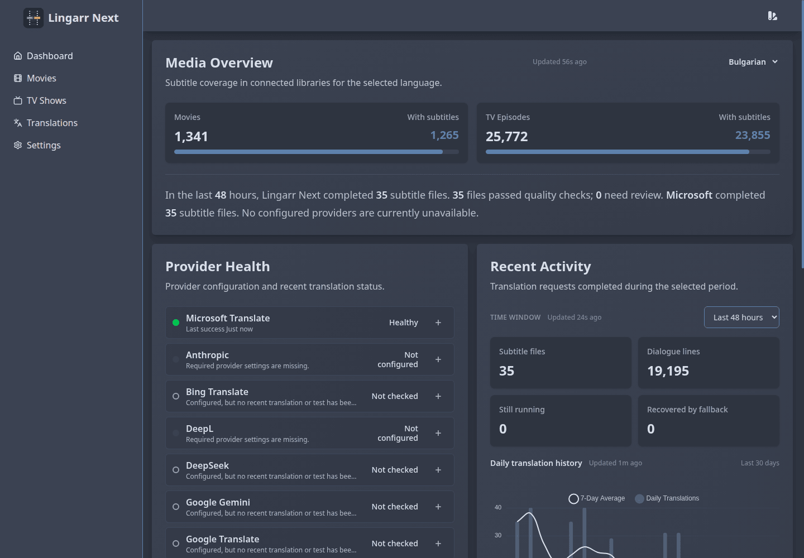
</p>

### Translation workflow

- Automatic discovery and translation for connected Sonarr and Radarr
  libraries.
- Manual and API-triggered translation, with an optional explicit subtitle path.
- Ordered provider fallbacks keep work moving when an earlier translator fails.
- Completed subtitles receive a deterministic score from 0 to 100, and the
  Translations list shows source, target, status, quality, progress, and
  compact relative completion times.
- An English picture subtitle or closed caption inside a video can become a
  text file before translation. Picture conversion waits 72 hours and is the
  last resort. An OCR file keeps an `ocr` tag in the name.
- When no source subtitle is on disk, Lingarr can ask Bazarr. That switch
  starts off, a miss is retried for up to 7 days, and a downloaded file can
  replace one Lingarr made by OCR.
- Providers can fetch a source or target subtitle from configured sites before
  translation. A matching target is placed and the media server is notified.

<p align="center">
  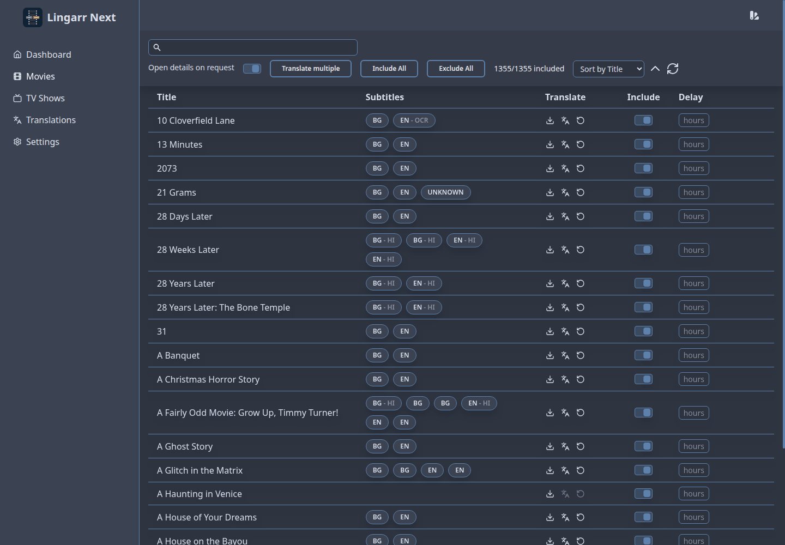
  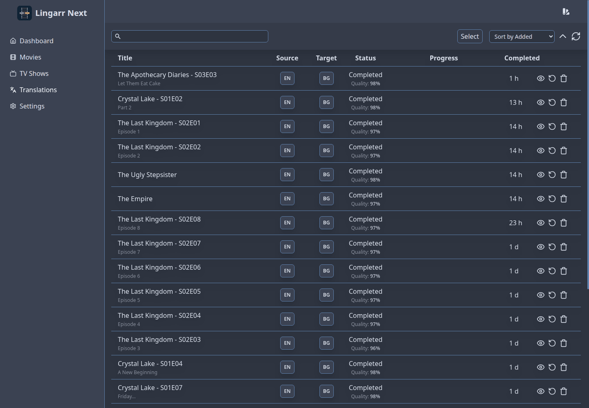
</p>

### Translation providers

| Category | Providers |
| --- | --- |
| Free and web translators | Microsoft Translate, Google Translate, Bing Translate, Yandex Translate |
| Hosted translation APIs | DeepL, LibreTranslate |
| AI providers | OpenRouter, OpenAI, Anthropic, DeepSeek, Google Gemini, Qwen General AI, Qwen Translation, Z.ai Coding Plan, OpenCode Go, xAI API, xAI SuperGrok and Premium+ |
| Self-hosted AI | LocalAI, Ollama, and compatible OpenAI-style endpoints |

AI services expose model selectors where the provider supports them. OpenRouter
keeps `openrouter/free` first for inexpensive bulk work, with `openrouter/auto`
second and the rest of the catalogue after it. Qwen appears in two forms:
general models support instruction profiles, while Qwen Translation uses
Qwen-MT's purpose-built language controls. xAI appears as a conventional
developer API and as an experimental device-login connection for SuperGrok and
Premium+ accounts.

### Instruction profiles

- Separate **System Prompt** and **Context Prompt** libraries.
- Create, rename, duplicate, version, activate, and delete profiles.
- Assign profiles to individual AI provider rows or inherit the active default.
- Built-in examples cover translation role, tone, profanity, names, glossary,
  captions, readability, ambiguity, and final-output rules.
- Existing prompt placeholders remain available, including source and target
  language and dialogue-context tags.

### Settings and plugins

- Settings are grouped into **Connections**, **Translation**, **Automation**,
  **System**, and **Plugins**.
- Plugins load from `PLUGINS_PATH`. Each plugin is its own card, and the switch
  in the upper right turns it on. An off card is dim.
- Jellyfin Item Added and Emby library.new queue a new movie or episode the
  same way a Plex library.new event does. Radarr and Sonarr webhooks stay.
- System logs open on the newest lines. Older lines load as you scroll up, and
  a warning or error includes a short next step.
- Translation has local **Setup**, **Providers**, **Subtitles**, **Prompts**,
  and **Advanced** tabs.

<p align="center">
  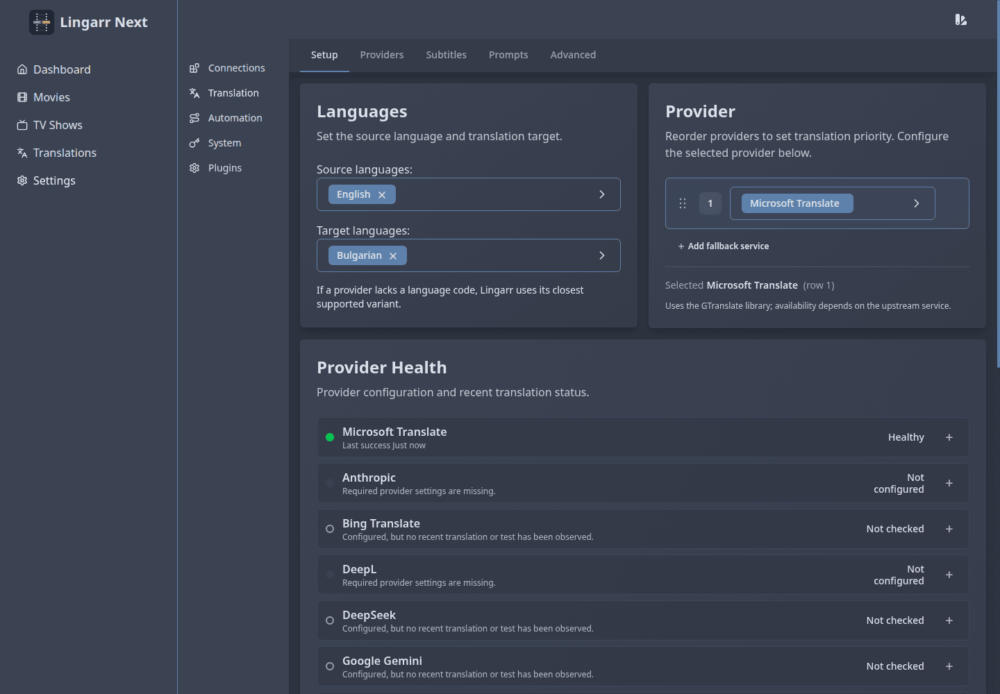
  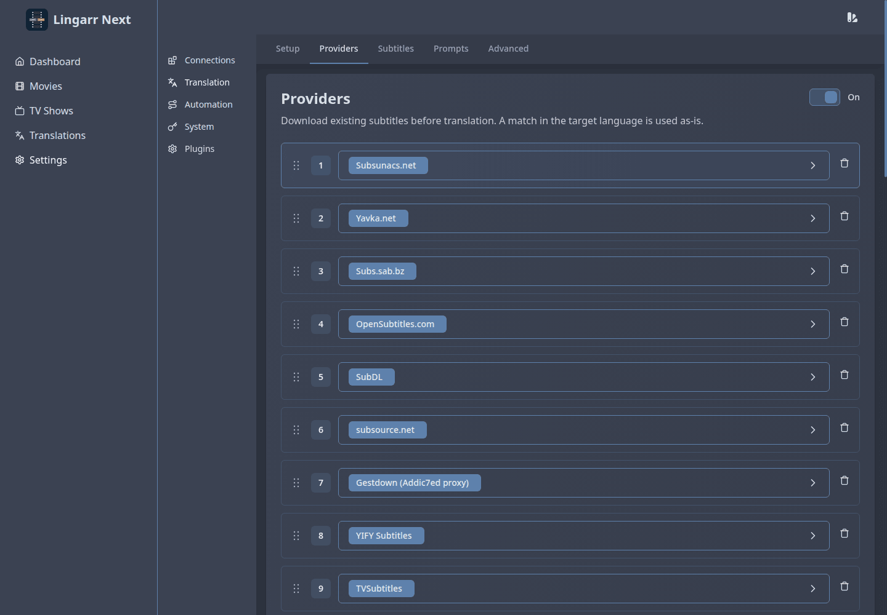
</p>

<p align="center">
  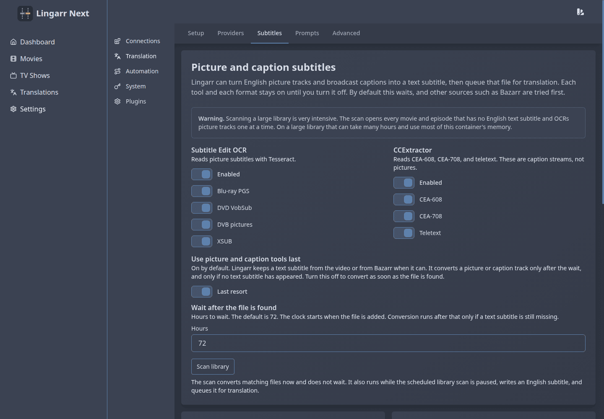
  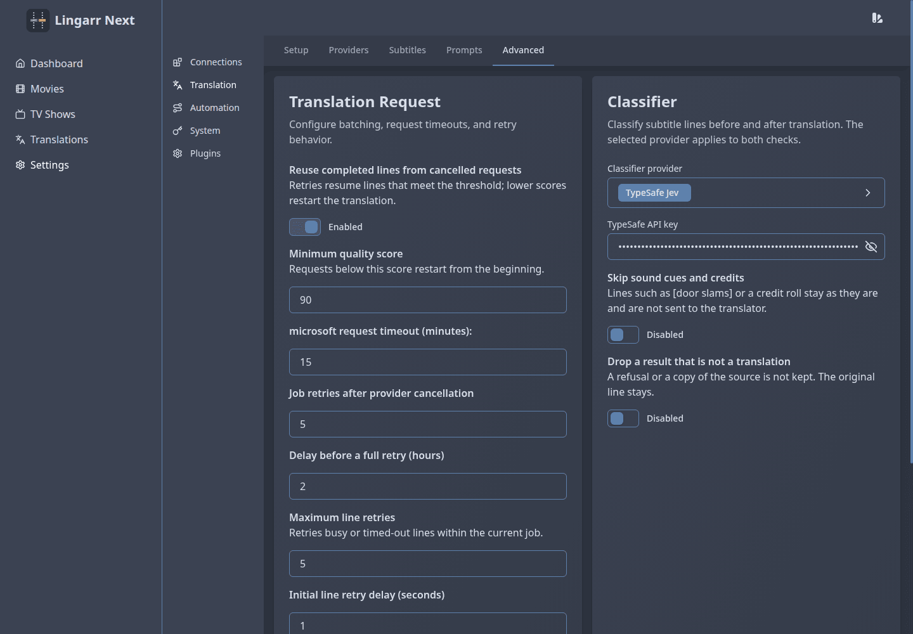
</p>

<p align="center">
  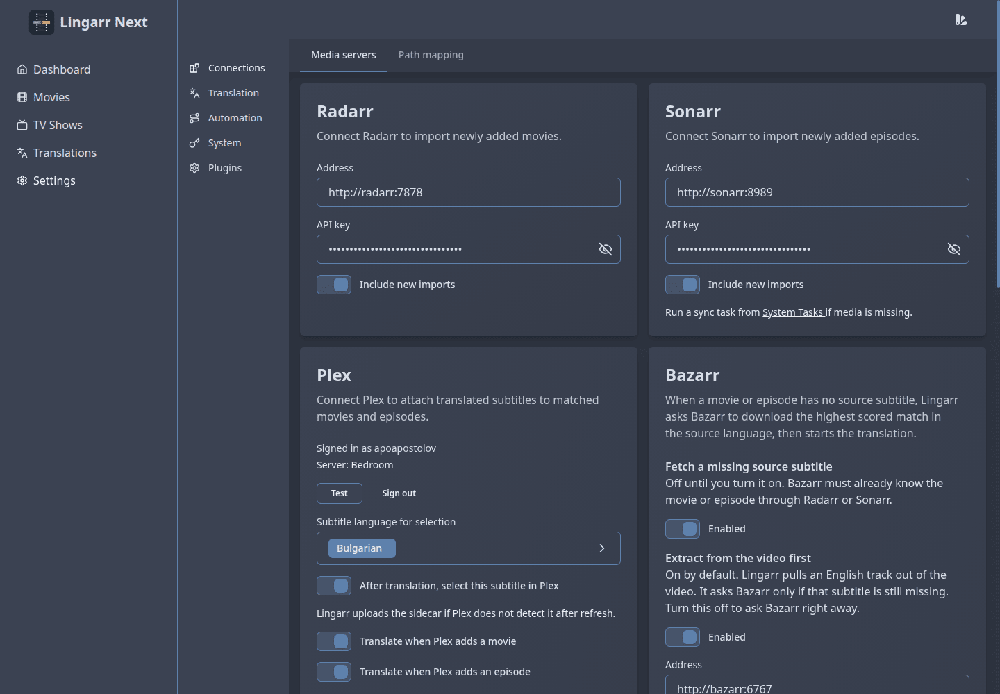
  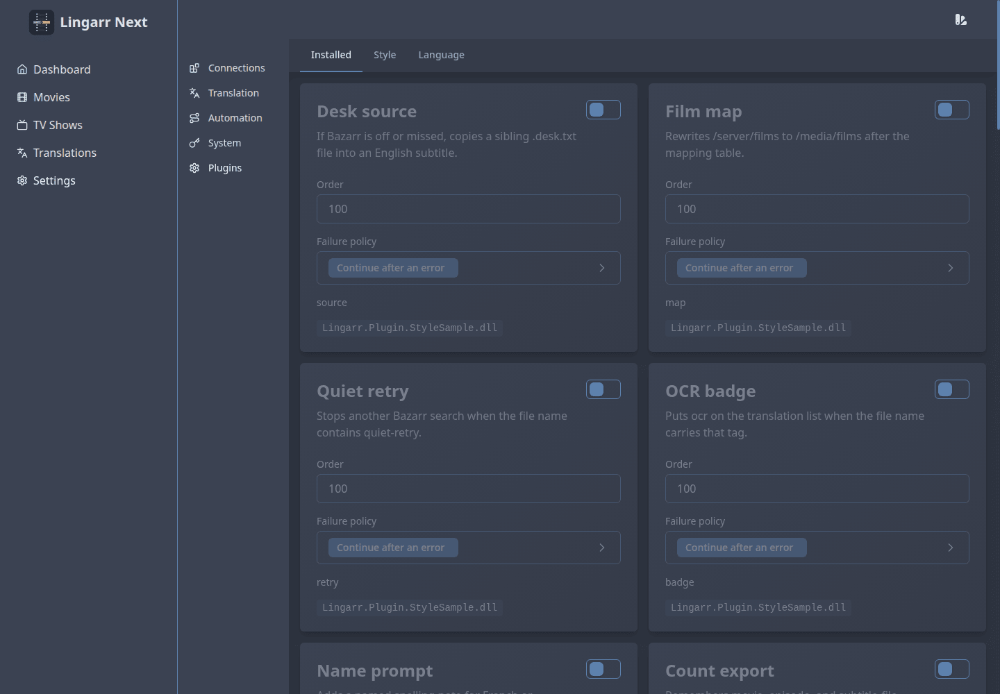
</p>

<p align="center">
  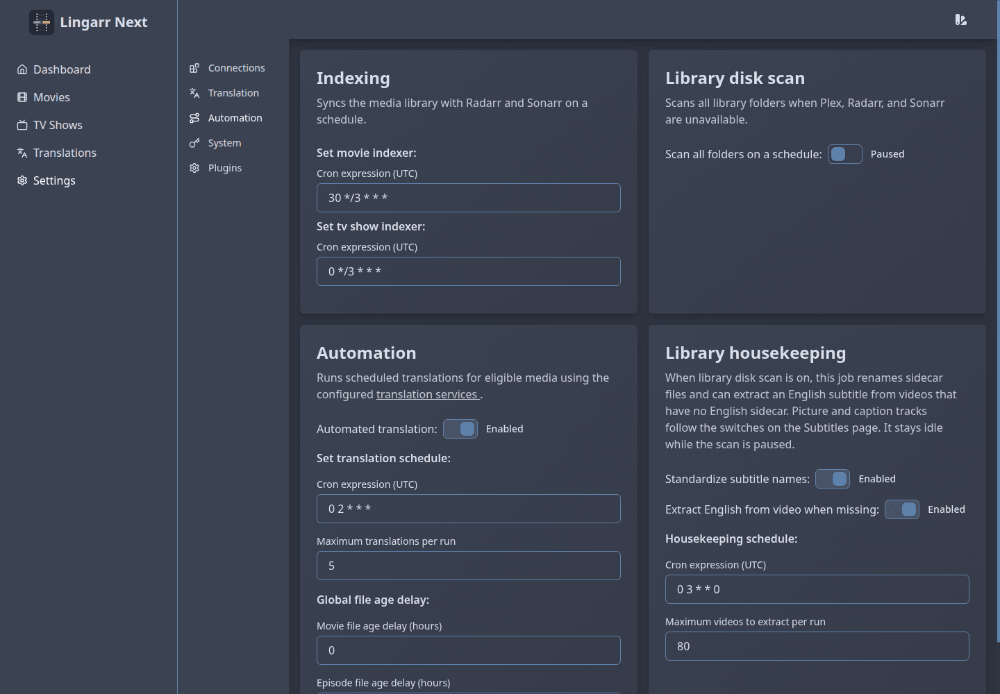
  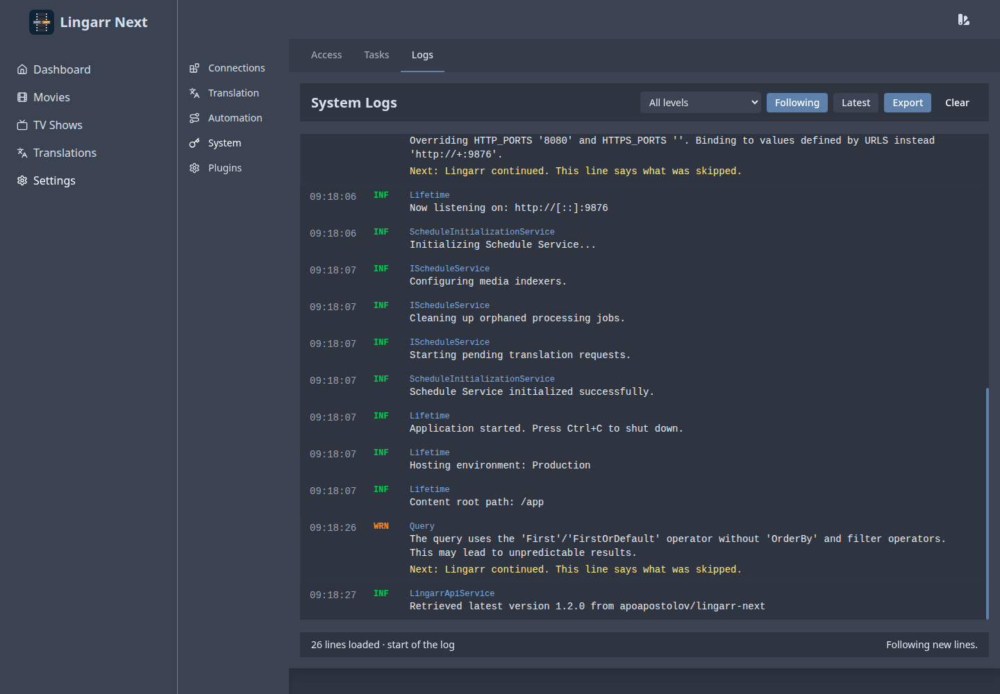
</p>

### Operational notes

Discovery avoids unbounded recursive scans, skips trailer folders, and still
finds conventional subtitle directories. The daily check uses Plex, Radarr, and
Sonarr rather than walking every folder, with a full scan as the fallback when
none of them is connected and the library scan switch is on. API keys stay
encrypted, and health and usage records never store subtitle text, prompts,
credentials, or media paths. Microsoft and Google requests use longer
provider-specific timeouts with a transient retry.

## Quick start

The shortest install uses SQLite and the published multi-architecture
container:

```yaml
services:
  lingarr:
    image: ghcr.io/apoapostolov/lingarr-next:latest
    container_name: lingarr
    restart: unless-stopped
    ports:
      - "9876:9876"
    environment:
      ASPNETCORE_URLS: http://+:9876
      DB_CONNECTION: sqlite
      SERVICE_TYPE: microsoft
      MAX_CONCURRENT_JOBS: 1
    volumes:
      - ./config:/app/config
      - /path/to/media/movies:/movies
      - /path/to/media/tv:/tv
```

Start it, then work through the app:

```bash
docker compose up -d
docker compose ps
```

1. Open `http://localhost:9876`.
2. Connect Sonarr, Radarr, or Plex under **Settings, Connections**, and set the
   media paths to match the container volumes.
3. Choose providers under **Settings, Translation, Setup**. Drag the chain into
   the order you want.
4. Set `PLUGINS_PATH` before starting if you want plugins. They stay off until
   you enable each card.

MySQL and PostgreSQL remain supported for larger or existing installations.
Docker secrets can be supplied with the `_FILE` form of supported environment
variables. `JOB_TIMEOUT_MINUTES` sets how long a silent SQLite Hangfire job
waits before it is retried, and the default is 30.

## Latest release

**1.2.5, Clean Manifests.** All eight open dependency advisories are closed.
Each one was a transitive dependency of the documentation site's builder, and
the application itself is unchanged, so an existing install behaves the same
after upgrading.

**1.2.4, Language Priority.** The order you set for source and target languages
is now kept, and the higher match wins. API keys and Plex tokens supplied
through environment variables are encrypted before they are saved, with
existing plain-text keys converted on startup. A job that cannot be queued now
shows as Failed with the reason instead of sitting as Pending.

Full history and per-release detail: [CHANGELOG.md](CHANGELOG.md).

## Updating and migration

Before changing from upstream Lingarr or an older fork build:

1. Back up `/app/config` and your application database.
2. Review [CHANGELOG.md](CHANGELOG.md), especially migrations and provider
   configuration.
3. Change the image to `ghcr.io/apoapostolov/lingarr-next:latest`.
4. Start the container and allow the automatic database migrations to finish.
5. Confirm the translation chain, paths, prompt profiles, and provider health
   before starting a large automated run.

## Configuration

Common environment variables:

| Variable | Purpose |
| --- | --- |
| `ASPNETCORE_URLS` | Internal listen URL; normally `http://+:9876` |
| `DB_CONNECTION` | `sqlite`, `mysql`, or `postgresql` |
| `SQLITE_DB_PATH` | Optional application SQLite path |
| `DB_HANGFIRE_SQLITE_PATH` | Optional Hangfire SQLite path |
| `MAX_CONCURRENT_JOBS` | Number of translation workers |
| `SERVICE_TYPE` | One provider or an ordered JSON provider and model chain |
| `SOURCE_LANGUAGES` | Minified JSON list of allowed source languages |
| `TARGET_LANGUAGES` | Minified JSON list of target languages |
| `RADARR_URL` / `RADARR_API_KEY` | Radarr connection |
| `SONARR_URL` / `SONARR_API_KEY` | Sonarr connection |
| `AUTH_ENABLED` | Enable Lingarr Next authentication |
| `BASE_PATH` | Optional reverse-proxy path prefix |
| `PLUGINS_PATH` | Folder of plugin DLLs. Empty disables plugins |

See [Settings.MD](Settings.MD) for the full environment-variable reference.

## Documentation

- [Documentation index](docs/README.md)
- [Architecture and request flows](docs/architecture.md)
- [Testing and live smoke checks](docs/testing.md)
- [AI providers, model selection, and fallback chains](docs/ai-providers-model-fallback-chain.md)
- [Provider health, subtitle quality, Dashboard, and instruction profiles](docs/proposals/translation-confidence-and-instruction-profiles.md)
- [Settings information architecture](docs/proposals/settings-page-ia-and-qol.md)
- [Developer API documentation](Lingarr.Docs/developers/Plugins.md)
- [API documentation sources](Lingarr.Docs/)
- [Development plan](DEVELOPMENT_PLAN.md)

## Development and contributing

Contributions, bug reports, and carefully reviewed AI-assisted work are welcome.
Contributors must understand and be able to explain submitted changes, and
low-effort generated output is not accepted merely because AI use is allowed.

Start with [CONTRIBUTING.md](CONTRIBUTING.md), [AGENTS.md](AGENTS.md), and the
[testing guide](docs/testing.md).

## Credits and lineage

Lingarr Next is built on the work of the
[Lingarr project](https://github.com/lingarr-translate/lingarr) and its
contributors. Upstream remains a source for selective, reviewed imports. This
fork has its own roadmap, releases, container images, update checks, and support
expectations.

- Icons: [Lucide](https://lucide.dev/icons)
- Subtitle parsing: [SubtitlesParser](https://github.com/AlexPoint/SubtitlesParser)
- Translation support: LibreTranslate, GTranslate, and the provider projects
  listed above

## License

GNU Affero General Public License v3.0. See [LICENSE](LICENSE).
